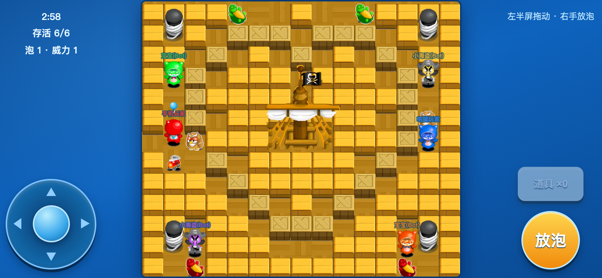

# 泡泡堂 BnB · 手机触控与飞牛 OS 部署版

**来源仓库：[tpoisonooo/BnB](https://github.com/tpoisonooo/BnB)。本仓库由该项目 Fork 而来，在原作基础上增加手机触屏操作和 Docker / 飞牛 fnOS 部署支持。原游戏及素材工作归原作者和对应权利人所有。**

上游基线：[5c108e8](https://github.com/tpoisonooo/BnB/commit/5c108e8ad3ea07684d4666f60e6eec6c2f3e569e)。本分支：`mobile-fnos`。本次适配：`onlytoy`。

- [飞牛 OS 完整图形界面部署教程](docs/fnOS部署教程.md)
- [下载 NAS 部署包 bnb-fnos.zip](https://github.com/onlytoy/BnB/releases/download/v1.1.0-mobile/bnb-fnos.zip)
- [发布与校验文件](https://github.com/onlytoy/BnB/releases/tag/v1.1.0-mobile)
- [上游项目说明、玩法与素材致谢](docs/上游项目说明.md)

## 手机版改动

- **左半屏任意位置按住拖动**：手指落下的位置是摇杆起点，向上、下、左、右拖动即可移动，松手停止；不需要精准按中左下圆圈。
- 右侧放泡和道具按钮，支持边走边放泡；有遥控水泡时显示“引爆”，被困且有针时显示“自救”。
- 地图居中，按比例尽量占满可用空间；时间和属性放左侧，操作提示放右侧。
- 手机横竖屏、大厅和房间布局适配；切后台、失焦、取消触摸、旋转屏幕时清空移动输入。
- 页面误放大后可双指收拢恢复视图；聊天框使用 16px 字号，固定文字缩放比例，减少 Safari 输入和旋转时的放大问题。
- 保留电脑方向键 / WASD、空格、Ctrl / Shift，以及上游房间、Bot、地图和联机规则。



## 飞牛 OS 部署

推荐下载上面的 **bnb-fnos.zip**，解压后把整个 `bnb-fnos` 文件夹上传到飞牛“我的文件 / docker”。打开 **Docker → Compose → 新增项目**，路径选择该文件夹，粘贴[完整教程](docs/fnOS部署教程.md)中的配置并启动。

部署包已经包含纯 JavaScript 运行依赖。NAS 首次启动只需拉取 `node:24-alpine`，不需要在 NAS 执行 npm 安装或构建。

浏览器访问 `http://NAS的局域网IP:3001/`。手机连接同一局域网后打开相同网址，推荐横屏。

## 从源码使用 Docker 部署

```bash
git clone --branch mobile-fnos https://github.com/onlytoy/BnB.git
cd BnB
docker compose up -d --build
docker compose ps
```

这条路线使用仓库根目录的 `Dockerfile` 和 `compose.yaml`，首次构建需要访问 Node 镜像仓库及 npm。无需数据库或额外 Nginx。修改访问端口时只调整 `compose.yaml` 中 `3001:3001` 的左侧端口。

## 本地运行与验证

需要 Node.js 24：

```bash
npm ci
npm start
# 浏览器打开 http://localhost:3001/
```

```bash
npm test
npm run verify:mobile
npm run verify:zoom
```

后两项需要已安装 Chrome / Chromium。macOS 默认使用 Google Chrome；其他系统通过 `CHROME_PATH` 指定可执行文件，例如 `CHROME_PATH=/usr/bin/chromium npm run verify:mobile`。检查截图和报告保存在 `artifacts/mobile/`，不进入 Git。

已完成 30 项原游戏测试，以及手机多点触控、浮动摇杆、边走边放泡、道具、松手停止、横竖屏和缩放恢复的浏览器模拟验证。尚未针对每种实体 iPhone / Android 设备逐机验证。

重新制作 NAS 包：安装生产依赖后执行 `python3 scripts/package-nas.py`，详见[部署教程](docs/fnOS部署教程.md)。

## 运行说明

Node.js 同时提供网页和 WebSocket，默认端口 3001，健康接口为 `/healthz`。房间和对局存在内存中，服务重启后清空。域名反代使用独立域名的根路径，后端填写 `http://NAS的局域网IP:3001`。Lucky 默认支持 WebSocket，详细填写方式见部署教程。

## 来源与版权

- 原始项目：[tpoisonooo/BnB](https://github.com/tpoisonooo/BnB)，原作者的复刻过程见[上游 issue](https://github.com/tpoisonooo/BnB/issues/1)。
- 上游致谢的素材项目包括 [visolleon/bnb](https://github.com/visolleon/bnb)、[SineYuan/BnBonline](https://github.com/SineYuan/BnBonline)、[NPpj/CrazyArcade](https://github.com/NPpj/CrazyArcade)。完整说明保存在[上游项目说明](docs/上游项目说明.md)。
- 《泡泡堂》原作素材版权归盛趣游戏（原盛大网络）/ Nexon 所有。沿用上游的学习和研究用途说明；本次移动端适配不改变原素材的权利归属，也不额外声明拥有上游代码或素材版权。
